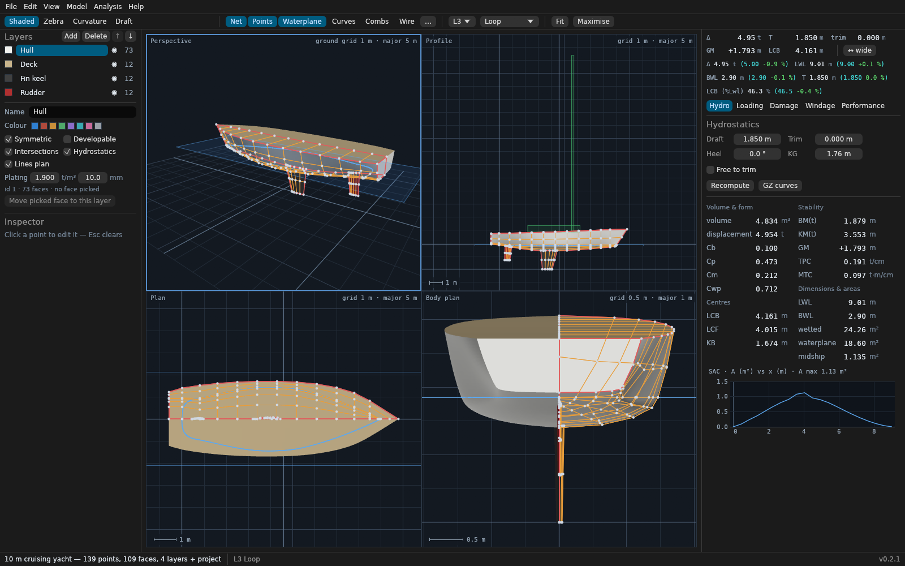
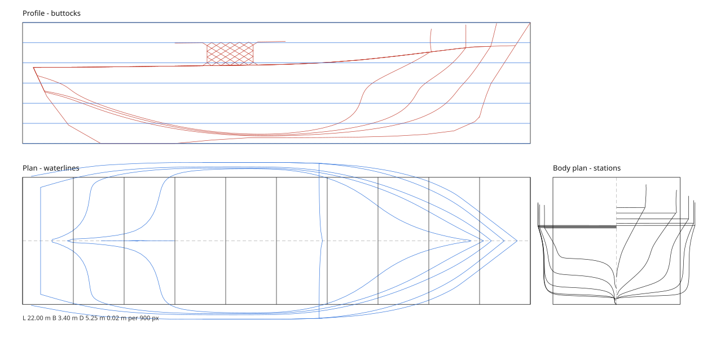

# SeaCraft — hull design and naval architecture in Rust

Website: <https://havan.github.io/SeaCraft/>

SeaCraft is an independent Rust reimplementation of the open-source
[FREE!ship](https://sourceforge.net/projects/freeship/) hull-design program.
It reproduces FREE!ship's modelling kernel and its naval-architecture
measurement pipeline, and it reads and writes FREE!ship's `.fef` exchange
format so control nets can move between the two applications.

FREE!ship itself is a Delphi (Object Pascal) application released under the
GNU GPL. Its descendant **FREE!ship Plus** (Victor Timoshenko) and its
Lazarus port **FreeShip Plus in Lazarus** (Mark Malakanov) continue the same
codebase. SeaCraft is written from FREE!ship's documented behaviour and its
GPL source; it is not a line-by-line translation.

> **Not validated.** Most simulation calculations have not been checked against tank tests, sea
> trials or approved software, and results may be wrong. A `PASS` against a criterion is not approval.
> Do not rely on SeaCraft for design or safety decisions without independent checks by a qualified
> person. It is provided as is, with no warranty; see [`DISCLAIMER.md`](DISCLAIMER.md).





---

## 1. How FREE!ship works (investigation notes)

### 1.1 Modelling: subdivision surfaces instead of NURBS

FREE!ship's core idea is that a hull is a **subdivision surface** — a coarse
*control net* of polygons that the program repeatedly refines and smooths.
The designer moves control points; the program shows the smooth limit surface.
This gives more freedom than NURBS because the control grid need not be
rectangular: holes, knuckles and local detail are just extra polygons.

The refinement is a hybrid of **Loop** and **Catmull–Clark** subdivision
("quad-triangle subdivision"). In the FREE!ship sources this is
`TFreeSubdivisionSurface.SubDivide` (`Units/FreeGeometry.pas`):

1. Every face is split by inserting an **edge point** in the middle of each
   edge and, for faces with more than three corners, a **face point** at the
   centroid. Triangles split into four triangles; larger faces connect each
   edge point to the face point.
2. Every point is then moved by an **averaging** step that combines the new
   face/edge points with the original vertex position. The averaging weights
   depend on the vertex type — regular, crease, corner, boundary — so that
   creases (knuckle lines) and corners are preserved instead of being
   smoothed away.
3. The resulting mesh replaces the old one; repeating the two steps `n` times
   is "subdivision level `n`".

Key practical consequences that SeaCraft mirrors:

* Faces must be consistently wound and normals must point **outward** —
  hydrostatics integrates the volume "behind" the faces.
* Edges should have exactly two adjacent faces except at deliberate boundary
  edges. An open deck is closed with flat lids over each boundary loop, so
  it stays buoyant when the sheer goes under (heel, overload) and a warning
  says so; any other submerged opening is a leak the lids only paper over.
* Crease edges keep a knuckle sharp; corner points are pinned.
* Layers group faces and carry per-layer flags (visible, symmetric,
  use-in-hydrostatics, material density, plate thickness).

### 1.2 Exchange format: `.fef`

`TFreeSubdivisionSurface.ExportFEFFile` / `ImportFEFFile` define a plain-text
format: layer count and layer records, then control points, control edges and
control faces. It is the format SeaCraft parses and writes, which makes it a
practical bridge to the original program (see `crates/seacraft-core/src/fef.rs`).

### 1.3 Hydrostatics: panel integration

FREE!ship does **not** use ordinate tables. `TFreeHydrostaticCalc.Calculate`
(`Units/FreeShipUnit.pas`) integrates the refined surface directly:

* The hull is refined to the current subdivision level.
* Every triangle is clipped against the waterplane.
* Volume and the centre of buoyancy come from the divergence theorem over the
  submerged panels; the waterplane closes the volume, so the projection origin
  is placed *in* the waterplane to cancel the lid's contribution.
* Wetted surface is the sum of the submerged panel areas.
* The waterline is the intersection of the mesh with the waterplane; chaining
  those segments gives waterplane area, centre of flotation and the transverse
  and longitudinal second moments, hence `BM = I / ∇` and `KM = KB + BM`.
* Section areas along the hull give the section-area curve; the centreline cut
  gives the lateral (profile) area.
* Coefficients follow from these: `Cb = ∇/(L·B·T)`, `Cp = ∇/(Am·L)`,
  `Cm = Am/(B·T)`, `Cwp = Awp/(L·B)`.
* Heel and trim are handled by tilting the waterplane, so the same panel
  machinery yields cross curves (`KN`) and, with `KG`, righting levers (`GZ`).

### 1.4 Other FREE!ship features

* **Intersections / linesplan** — stations, buttocks, waterlines and diagonals
  are computed by cutting the refined surface with planes and are drawn as a
  conventional three-view linesplan.
* **Unfolding (developability)** — flat-plate development of (near-)developable
  surface regions, with a check of the 3D area against the unfolded area.
* **Exports** — OBJ, STL, DXF, IGES (NURBS), VRML, GHS and its own `.fef`.
* **Hullform transformation** — Lackenby transformation to hit a target `Cb`,
  `Cp` and `LCB`.

---

## 2. What SeaCraft implements

| FREE!ship concept | SeaCraft module |
| --- | --- |
| Control net, layers, creases | `crates/seacraft-core/src/mesh.rs` |
| Loop / Catmull–Clark refinement | `subdiv.rs` |
| `.fef` import/export | `fef.rs` |
| Panel hydrostatics, coefficients, SAC | `hydro.rs` |
| Cross curves, `KN`/`GZ`, draft/trim solving, IMO A.749 | `stability.rs` |
| Loading conditions, tanks, free-surface correction (`FSC`) | `loading.rs` |
| Stations / buttocks / waterlines (SVG, DXF, IGES, 3D combs) | `linesplan.rs` |
| AutoCAD 2000 DXF writer | `dxf.rs` |
| IGES 5.3 B-spline curve (126) & surface (128) writer | `iges.rs` |
| Watertight vertex welding + 3MF 1.3 archive writer | `threemf.rs` |
| Curvature, zebra and draft analysis | `analysis.rs` |
| CPU z-buffer rasterizer + waterplane depth + PNG | `raster.rs` |
| OBJ / STL / 3MF / PLY / IGES / HTML viewer | `export.rs` |
| Deterministic damage stability (lost buoyancy) | `damage.rs` |
| IMO 2008 IS Code weather criterion | `weather.rs` |
| Holtrop & Mennen still-water resistance | `resistance.rs` |
| Michell thin-ship wave resistance | `michell.rs` |
| Savitsky planing hull resistance | `planing.rs` |
| Strip-theory heave and pitch motions | `seakeeping.rs` |
| Irregular head seas, significant motions, MSI | `seastate.rs` |
| Trim optimisation at a speed | `trimopt.rs` |
| Hydrostatics table, table of offsets, Bonjean curves | `table.rs`, `offsets.rs`, `curves.rs` |
| Lackenby-style station shift | `lackenby.rs` |
| Scale, translate and mirror | `transform.rs` |
| Split a face, insert an edge, toggle a crease | `topology.rs` |
| Developable plate expansion | `develop.rs` |
| Project sidecar (loading, damage, windage, report settings) | `project.rs` |
| Design report (self-contained HTML) | `report.rs` |
| Example hull library | `examples/` |
| Control channel token and path sandboxing | `control_auth.rs` |
| Parametric demo hull | `demo.rs` |
| Parametric hull generator (`displacement`, `planing`, `yacht`) | `parametric.rs` |
| Resistance optimiser (Nelder–Mead over Cp, LCB, L/B) | `optimize.rs` |
| Command-line front end + MCP stdio server (`seacraft mcp`) | `crates/seacraft-cli` |
| Desktop modeller (4 viewports, drag, docks, `--control`) | `crates/seacraft-gui` |

### Modelling kernel

`subdiv::evaluate` refines a `Surface` to a given level. `SubdivisionMode`
selects the FREE!ship default (`Loop`: triangles become four triangles, larger
faces become quads) or pure Catmull–Clark. Creases, corners and boundary
vertices keep their FREE!ship weights. `evaluate_full` additionally mirrors
symmetric layers so the whole hull is produced.

### Hydrostatics

`hydro::Hull` refines once and can then be measured for many floating
conditions, which is what the stability solver does. `hydro::compute` returns
volume, displacement, `LCB`, `KB`, waterplane area/inertia, `LCF`, `BM`, `KM`,
all the coefficients, the section-area curve and the lateral area. The results
are serde-serialisable and available as JSON from the CLI.

`curves::bonjean` builds the Bonjean family: the submerged section area at each
station against a range of drafts (`seacraft bonjean`), plus an area-curve
prismatic coefficient from the section-area curve. Both curves plot to
standalone SVG with no external dependency, and both are cut from the same
refined mesh and clipping path as the hydrostatics.

`transform::fit_to_targets` rescales the control net to a target waterline
length, beam and draft (`seacraft transform`), and `transform::apply` /
`transform::mirror` translate or reflect it. The scale is anchored at the aft
end, the centreline and the keel, so a stretched hull keeps its transom, its
symmetry and its ground line; a mirror reverses every face's winding, because a
reflection would otherwise turn the outward normals inward and measure the
displacement negative.

`resistance` implements Holtrop–Mennen still-water resistance (the 1982/1984
coefficient set, including the high-speed `c17`/`m3` wave fit above `Fn` 0.55 and
the paper's own interpolation between 0.40 and 0.55):
`RT = RF(1+k1) + RAPP + RW + RB + RTR + RA` on the ITTC-57 friction line, with
`PE = RT·V` and no propeller model, so it reports the power the hull needs
rather than the power the engine delivers. Everything the method takes from the
hull form — `LWL`, `BWL`, `CB`, `Cp`, `Cm`, `LCB` as a percentage of the length,
the wetted surface, the immersed transom and the half-angle of entrance `iE` —
is measured on the refined mesh. `seacraft resistance` prints the breakdown and
warns when the hull falls outside the ranges the method was fitted to. Given a
propeller diameter it also estimates Holtrop's wake fraction, thrust deduction
and relative rotative efficiency, and prints the power chain
`PD = PE/ηD`, `ηD = ηH·ηR·ηO`, `PS = PD/ηS` — with `ηO` supplied by the user from
an open-water chart, since the method predicts the hull's side of the bargain,
not the propeller's. The wake and thrust-deduction regressions are the
single-screw fits and are flagged when the answer leaves their range. The
implementation is checked against the worked example the paper prints for a
205 m ship: every coefficient and the wave, friction, correlation and appendage
terms reproduce to better than 1 %.

`michell` implements Michell's thin-ship wave resistance theory (1898) — the
theoretical foundation of Michlet — for slender displacement hulls and
catamarans (`Fn` 0.2–1.0, `L/B` ≥ 6). It samples half-breadths on a regular
centreplane grid `y = f(x, z) >= 0` directly from the refined mesh, evaluates
closed-form Filon/panel Fourier integrals in `x` and `z`, and integrates the
directional wave energy spectrum over wave angles `theta` in `[0, pi/2)`. For
catamarans, the demihull interference factor `2 * (1 + cos(k0 * s * sec(theta) * tan(theta)))`
superimposes the twin wave patterns at centreline separation `s`, which converges
to `2 * R_W(monohull)` as separation grows. Total resistance pairs Michell wave
resistance with the ITTC-57 friction line and form factor `1+k` (`seacraft resistance --method michell`).

`dsyhs` implements the Delft Systematic Yacht Hull Series (DSYHS) upright
bare-hull residuary resistance regression (Keuning & Katgert, 2008, extending
Keuning & Sonnenberg, 1998) for sailing yacht hulls (`Fn` 0.15–0.75). The
polynomial evaluates `R_r / (∇·ρ·g) = (∇^(1/3)/LWL)·(a0 + a1·LCB/LWL + a2·Cp + a3·∇^(2/3)/Aw + a4·BWL/LWL + a5·LCB/LCF + a6·BWL/Tc + a7·Cm)`
with linear interpolation between tabulated Froude numbers and clamping without
extrapolation. Longitudinal centres of buoyancy and flotation are referenced
to the forward perpendicular (FPP, positive aft) per the series convention.
Frictional resistance follows the ITTC-57 correlation line on the canoe-body
wetted surface using the series' Reynolds length `0.7·LWL` with `1+k = 1.0`
(`seacraft resistance <hull> --method dsyhs`).

`topology` edits the control net without moving the surface (`seacraft edit`):
`split_face` fans a face around its centroid, `insert_edge` joins two
non-adjacent points of a face, and `set_crease` makes an edge hard through
subdivision. Both splits are interior to a face, so every new edge keeps two
adjacent faces — the net stays closed and manifold, and the tests assert it by
counting faces per edge rather than by eye. On a planar face the geometry is
untouched; on a curved quad the fan refines to a slightly different surface
(0.04 % of displacement on the demo hull), which is a property of subdivision,
not of the edit.

`develop` flattens a hull patch into the sheet a plate would be cut from
(`seacraft unfold`). The patch is selected as a simply connected plate — between
two waterlines *and* two stations, or between two buttocks and two stations — and
developed by edge-joining: each face is laid flat by an isometry across the edge
it shares with a face already placed, so the areas are preserved exactly and the
strain shows up as **seam gap** where the flattened patch refuses to close. The
report gives the flat pattern size, the maximum and RMS gap, and the mean
Gaussian curvature from the same discrete operator the curvature shading uses;
under 0.5 % of the plate diagonal it is called developable. `-o plate.svg` writes
the flat pattern with its outline.

`planing` is Savitsky's method for a prismatic planing hull
(`seacraft planing`): lift, mean wetted length, trim and drag at each speed, with
the trim solved so the centre of pressure sits under the centre of gravity. The
tests check the physics the method must satisfy — lift equilibrium to 1e-6, λ
falling as trim rises, the drag hump — rather than a golden number. Deadrise is
measured as the tangent at the keel of the transom section, which is exact for a
hard-chine V and understates a round-bilge hull; `--deadrise` overrides it.

`offsets::table_of_offsets` produces the drawing-office table — half-breadths
at stations x waterlines and buttock heights at stations x buttocks — as a
terminal table, long-format CSV, JSON or a standalone HTML page
(`seacraft offsets`). A cell the section cannot reach is empty (`-`), not zero.

`optimize` closes the design loop (`seacraft optimize hull.fef --speed 8 -o better.fef`,
MCP tool `optimize_hull`, app method `model.optimize`): a dependency-free
Nelder–Mead search (`optimize.rs`) over up to three shape variables — a change in
`Cp` and in `LCB` by the Lackenby station shift, and an `L/B` stretch (`x` scaled by
`s`, `y` by `1/s`, so `L/B` becomes `s²` times larger) — with the draft re-solved
after every candidate so the displacement is held. Each candidate is measured on
the refined mesh and scored by `R_T` at the design speed (Holtrop–Mennen, or
Savitsky for a planing hull) plus quadratic penalties for displacement error,
`GM` below `--min-gm` (with `--kg`), `LCB` outside `--lcb-band` and new
validity warnings. The answer is the cheapest *evaluated* hull that meets those
constraints, so it is never worse than the starting hull when that is itself
feasible. It is a local search of a few smooth parameters, not a form optimiser:
the sections, ends and topology do not change, the station shift has limited
authority (the report says when a target was out of reach), and a variable that
ends on its bound is flagged. In the MCP server it **edits the model**; `batch`
rolls it back on a later failure and the app records it in its undo history.

### Parametric hull generation

`parametric::generate` (`seacraft generate` / MCP `generate_hull`) builds a
symmetric half-model control net from principal dimensions (`--kind
displacement|planing|yacht`, `--lwl`, `--beam`, `--draft`, `--depth`), scales it
so level-3 refined `LWL`, `BWL` and `T` match within 0.5 %, and optionally
solves section/longitudinal fullness for `--cb` and station shifts for `--lcb`:

```console
seacraft generate --kind planing --lwl 10 --beam 3.2 --draft 0.6 --depth 1.8 --cb 0.45 --lcb 0.42 -o out.fef
```

### Example hulls

`examples::build` (`seacraft example`, MCP `example`, and *Start from:
Example* in the GUI's New design dialog) gives a ready-made model with its
`.seacraft.json` sidecar: the example's KG, its design requirements and a
"Design" loading condition that floats at the design waterline. The nets
are hand-authored station tables, calibrated once against level-3
hydrostatics and frozen; the committed `examples/<name>.fef` and
`.seacraft.json` are what `build` makes (a test checks it). Measured at
level 3, Loop, at the design draft, with Cm and Cp at the middle of the
waterline:

| name | vessel | LWL × BWL × T (m) | Δ (t) | Cb | Cp | Cm | Cwp | LCB (% LWL) | KG (m) | source of the targets |
|---|---|---|---|---|---|---|---|---|---|---|
| `yacht-10m` | 10 m fin-keel cruising yacht: canoe body with counter transom, closed deck, fin keel, spade rudder; GM 1.79 m, AVS 127° | 9.01 × 2.90 × 0.45 canoe body (1.85 total) | 4.95 | 0.401 | 0.547 | 0.732 | 0.712 | 46.5 | 1.76 above the keel tip | representative of production boats of this size; coefficients of the canoe body (appendage layers off, T = Tc), Δ with them on |
| `kayik-9m` | 9 m Aegean piyade kayık: round bilge on a deep keel and deadwood, raked stem, small transom, inboard diesel, 7 kn; T to the keel bottom | 7.97 × 2.86 × 0.907 | 4.60 | 0.218 | 0.442 | 0.492 | 0.632 | 47.4 | 0.95 (estimated) | means of 12 surveyed piyade boats in B. İ. Turan, "Tırhandil ve Piyade Tipi Tekne Formlarının Tasarım ve Mühendislik Perspektifinden Karşılaştırılması", *Journal of Marine and Engineering Technology (JoINMET)* 2(2), 78–90, 2022; the lines are SeaCraft's own (entrance half-angle ≈ 27° against the survey's 49°) |
| `runabout-6m` | 6.5 m hard-chine outboard runabout, true deep-V (23°), flat transom raked 12° | 5.64 × 2.00 × 0.425 | 1.92 | 0.390 | 0.798 | 0.489 | 0.807 | 39.5 | 0.65 (assumed) | representative of production boats of this size |
| `container-230m` | 230 m container ship, bulbous bow, closed skeg, transom just above the DWL, Lpp 230 m, D 19 m | 232.63 × 32.20 × 10.80 | 53 349 | 0.643 | 0.655 | 0.982 | 0.831 | 49.1 (1.52 % Lpp aft of midship) | 14.05 (measured KM − 0.60) | KCS-like: particulars of the KRISO Container Ship benchmark (SIMMAN 2008), lines SeaCraft's own; Cb on LWL 0.644 |
| `trawler-22m` | 22 m steel stern trawler, skeg over the aft third, immersed transom raked 25°, deck, 1 m bulwark (not in hydrostatics); GM 0.83 m, IMO A.749 passes in the Design condition | 19.50 × 6.41 × 2.60 | 173.9 | 0.522 | 0.621 | 0.840 | 0.813 | 47.2 | 2.50 (assumed) | representative of vessels of this size |
| `wigley` (CLI and tests) | Wigley parabolic hull, L 10 m, B 1 m, D 1 m | 10.00 × 1.00 × 0.625 | 2.83 | 0.442 | 0.666 | 0.664 | 0.666 | 50.0 | 0.35 | closed form: Cb 4/9, Cp = Cm = Cwp 2/3, KB 0.625 T, BM 0.0857 B²/T |

```console
seacraft example --list
seacraft example runabout-6m -o runabout.fef     # also writes runabout.seacraft.json
seacraft example --all -o examples/              # regenerates the committed files
```

### Stability

`stability::cross_curves` floats the hull at a constant displacement for each
heel angle, then reports `KN` and `GZ = KN − KG·sin φ`. Two conditions are
supported. *Fixed trim* holds the trim and bisects on the draft only — fast,
but the `LCB` drifts away from the `LCG` as the hull heels. *Free to trim*
(`--free-trim`, `--lcg x`) solves `(draft, trim)` so the hull is in
longitudinal equilibrium at every heel; it costs a few more iterations and is
what a real boat does. With no `--lcg`, the upright `LCB` at the design draft
is used.

`loading::evaluate` (`seacraft loadcase hull.fef case.json` / MCP
`loading_condition`) evaluates a complete ship loading condition (lightship,
deadweight items and partially filled tanks, optionally clipped to the hull's
moulded volume): it sums displacement `Δ`, `LCG`, `TCG` and solid `KG`,
computes each slack tank's liquid centroid and free-surface moment `FSM = ρ·i_t`
(`0` when empty or pressed-up), applies the free-surface correction
`FSC = FSM / Δ` to obtain `KG_fluid = KG + FSC` and `GM_fluid = KM − KG_fluid`,
solves the free-trim equilibrium floating condition (`draft`, `trim`, `list`),
and evaluates GZ cross curves, IMO A.749 criteria, and the IMO 2008 IS Code
Part A §2.3 severe wind and rolling (weather) criterion at `KG_fluid`.
`weather::evaluate_weather` (`seacraft stability ... --weather` / MCP
`weather_criterion`) also evaluates the weather criterion standalone with
configurable bilge type (`round`, `sharp`, `keels:<Ak>`), superstructure
windage items (`--windage name:area:z`) and downflooding angle.

`damage::evaluate` (`seacraft damage hull.fef case.json` / MCP
`damage_stability`) evaluates deterministic damage stability by the
lost-buoyancy method: the flooded compartment volume below the waterplane is
deducted from the buoyant hull with permeability $\mu$, holding ship displacement
and KG constant. It solves damaged equilibrium (`draft`, `trim`, `heel`/list),
checks freeboard to the deck edge at the lowest point, samples the residual GZ
curve from equilibrium (heels 0–60°, free trim), and evaluates indicative
SOLAS-style residual criteria (SOLAS II-1 Reg. 7-2 spirit: range $\ge 15^\circ$,
max $GZ \ge 0.10$ m, area $\ge 0.015$ m·rad).

### Project file (`hull.seacraft.json`)

Design data that the `.fef` format has no place for lives in a sidecar next to
the model: `hull.fef` → `hull.seacraft.json` (`project::Project`). It holds
loading conditions, compartments, damage cases, superstructure windage and
report settings, so the `.fef` stays readable by FREE!ship. The GUI reads it
when it opens a model and writes it on save (only when it holds something, or
already exists; a sidecar it could not read is left untouched). The file is
tagged `"format": "seacraft-project"` with an integer `version`; a newer
version is refused rather than half read, and unknown keys survive a round
trip. `loadcase` and `damage` accept a project file in place of a bare case
(`--name` picks one, otherwise the first) and fall back to the model's sidecar
when no case file is given; `stability --weather` uses the sidecar's windage
when no `--windage` is given. GUI control: `project.get`, `project.set`;
MCP: `project_get`, `project_set`, and `loading_condition {name}` (`save_hull`
writes the sidecar too).

The GUI's **Loading panel** (View menu, or control `ui.set {"loading_panel":
true}`) edits the project's loading conditions — lightship, weights, tanks
with fill, density, permeability and box bounds — and computes the condition
on a worker thread (Compute): Δ, LCG/TCG, KG solid/fluid, FSM/FSC, draft,
trim, list, GM, the tank table, IMO A.749 and weather criteria with
PASS/FAIL, and the GZ curve. Control: `loading.compute {name}`.

The GUI's **Damage panel** (View menu, or control `ui.set {"damage_panel":
true}`) edits the project's shared compartments (permeability, hull clipping,
box bounds) and damage cases — selecting flooded compartments and setting the
intact condition either manually (Δ, KG, LCG, TCG) or from a project loading
condition via `loading_condition_name`. A worker thread computes damaged
equilibrium (lost buoyancy, draft, trim, heel, sinkage, freeboard), the flooded
compartment summary, indicative SOLAS II-1 Reg. 7-2 residual criteria with
PASS/FAIL, and the residual GZ curve. Control: `damage.compute {name}`. MCP:
`damage_stability {name}` evaluates cases from the sidecar.

The four viewports render the project's tanks and compartments in 3D wireframe
and translucent fill (View menu `Tanks & compartments` or control `ui.set
{"volumes": true}`). Tanks appear in amber with a liquid-blue sub-volume up to
the fluid surface height (or box-fill estimate); compartments appear in
grey-blue, turning red when flooded in the selected damage case. Clicking a
volume selects it, outlines it in bright accent, and opens and focuses the
corresponding Loading or Damage dock with the volume highlighted and scrolled
into view.

The unified right-hand design dock also provides the **Windage** tab (View menu
`Windage panel`, or control `ui.set {"windage_panel": true}`), sharing the dock
with Loading and Damage. It configures superstructure and deck windage items:
either as lateral profile rectangles (the `profile` field in project and
loading condition JSON: `{"x_min", "x_max", "z_min", "z_max"}` with automatic
area and vertical centroid synchronization) or as standalone area and vertical
centroid values with a "Draw as rectangle" button. The Profile viewport renders
items with profile rectangles as translucent green outlines in the $y = 0$ plane
(View menu `Windage outlines` or control `ui.set {"windage": true}`), drawn
brighter when selected. Clicking inside an outline in the Profile view selects
the windage item and opens the Windage tab. The panel displays totals ($\Sigma A$
and area-weighted $z$) and the IMO §2.3 severe wind and rolling (weather)
criterion summary from the loading panel's last compute.

The design dock also provides the **Performance** tab (View menu `Performance panel`,
or control `ui.set {"performance_panel": true}`), evaluating still-water resistance
curves and regular head-sea seakeeping RAOs at the design draft. Four resistance
methods are supported: Holtrop & Mennen (1984), Delft Systematic Yacht Hull Series
(DSYHS), Savitsky (1964) planing equilibrium, and Michell (1898) thin-ship wave
resistance. Seakeeping computes heave ($z/\zeta$) and pitch ($\theta/k\zeta$) RAOs
across wavelength ratios $\lambda/L$, deriving mass distribution from fluid $KG$
(defaulting to the latest loading computation or hydro dock) and $k_{yy}/L_{wl}$,
and reporting natural heave and pitch periods along with irregular frequency
warnings. Both resistance and seakeeping run on background worker threads with
generation counters, accompanied by interactive XY plots, tabular readouts, and
validity warnings in amber. Its *Sea state* section (spectrum, $H_s$, $T_p$, $\gamma$,
response points) adds significant heave, pitch, point motions, relative motion,
vertical accelerations and MSI in irregular head seas from the same RAO run.

### Seakeeping (strip-theory heave & pitch motions)

`seakeeping::head_sea_raos` (`seacraft seakeeping hull.fef --draft T` / MCP
`seakeeping_raos` / GUI control `seakeeping.compute`) implements linear strip
theory for heave and pitch motion Response Amplitude Operators (RAOs) in regular
head seas, following Salvesen, Tuck & Faltinsen (1970, *Ship motions and sea
loads*, SNAME Trans. 78):

* Sectional 2D heave added mass and damping are evaluated across waterline
  stations via Frank's pulsating close-fit source distribution method on the
  actual submerged station contour (with Lewis conformal form fallback). An
  interior free-surface lid (Ohmatsu 1975) removes the irregular frequencies of
  the panel method, so results are reliable at any frequency.
* The STF transom boundary terms at the aft end of the strip integration
  (radiation coefficients and the matching excitation, zero for a closed stern)
  are on by default; `--no-transom` (MCP/control `transom_terms: false`) leaves
  them out.
* Forward speed terms follow the STF formulation: coupled radiation terms
  $A_{35}, B_{35}, A_{53}, B_{53}$ satisfy the STF speed relationships
  ($A_{35} - A_{53} = -2(U/\omega_e^2) B_{33}$, $B_{35} - B_{53} = 2 U A_{33}$).
* Hydrostatic restoring couples heave ($C_{33} = \rho g A_{wp}$), waterplane
  longitudinal moments ($C_{35} = C_{53} = \rho g \int x \cdot b_{wl} dx$), and
  longitudinal metacentric stiffness ($C_{55} = \rho g \nabla GM_L$).
* Wave excitation force ($F_3$) and pitch moment ($F_5$) combine Froude–Krylov
  and diffraction components with sectional depth attenuation $e^{-k T^*}$.
* Solves the coupled $2 \times 2$ complex motion system per encounter frequency
  $\omega_e = \omega + \omega^2 U / g$, reporting non-dimensional heave
  amplitude $z_a / \zeta_a$, pitch amplitude $\theta_a / (k \zeta_a)$, phases, and
  natural heave/pitch frequencies.

#### Irregular head seas (`seastate`)

`seastate::irregular_head_sea` (`seacraft seakeeping hull.fef --draft T --hs M --tp S
[--gamma G] [--point NAME:X]...` / MCP `seakeeping_irregular` / GUI control
`seakeeping.irregular` / the Performance tab's *Sea state* section) integrates the
RAOs against a long-crested Bretschneider (ITTC two-parameter) or, with `--gamma`,
JONSWAP spectrum (normalised numerically to $m_0 = H_s^2/16$). The RAOs are computed
on $0.2\,\omega_p \ldots 5\,\omega_p$ and the response moments
$m_n = \int |H|^2 \omega_e^n S(\omega)\,d\omega$ run over the incident frequency.
Reported per response: significant amplitude $2\sqrt{m_0}$, RMS and the mean
zero-crossing encounter period — for heave (m), pitch (deg, bow up) and, at each
point (default the LCG and the forward end of the waterline; `--point NAME:X` adds
others at model $x$), vertical motion, motion relative to the wave surface and
vertical acceleration (m/s², g). The motion sickness incidence follows O'Hanlon &
McCauley (1974) for a 2-hour exposure, from the mean absolute acceleration
$0.798\,\sigma_a$ at the acceleration's mean zero-crossing encounter frequency.
Head seas only, linear and long-crested; with `--json` the result is the
`irregular` object. Oracles: `docs/oracles.md` §17.

### Fairing analysis

Fairing a hull means looking at how light reflects off it. `analysis` computes
per-vertex normals and discrete curvature (cotangent Laplacian for the mean
curvature, angle deficit for the Gaussian one) and provides three analysis
shades:

* **Zebra** — reflection stripes; an unfair bump shows up as a kink in a band.
* **Curvature** — false colour from flat (blue) through medium (green) to tight
  (red), with `--radius` the curvature at which it saturates.
* **Draft** — green where the surface can be pulled from +z at more than the
  draft angle, red on undercuts.

### Design dossier

`seacraft report` (and the `design_report` MCP tool) compiles a self-contained
HTML5 design dossier for a hull: principal particulars, inlined linesplan SVG,
hydrostatics table, sectional area curve SVG, GZ cross curves and IMO A.749
intact-stability evaluation, and Holtrop–Mennen powering curves.

```console
seacraft report hull.fef -o report.html --kg 1.2
```

With a project file the dossier also gets **Loading Conditions** (summary,
IMO A.749, weather criterion, GZ curve per condition), **Damage Cases**
(intact vs damaged equilibrium, flooded compartments, residual criteria and
GZ) and **Seakeeping** (RAO table and, with a sea state, significant motions
and MSI). The project's `report` settings choose them: `loading_conditions` /
`damage_cases` (name lists, all when absent), `include_weather`, and
`seakeeping {speed_kn, kg?, sea?}`, besides draft, KG, LCG, speeds and the
resistance/planing switches. Precedence: defaults from the hull, then the
project's settings, then explicit CLI flags (`--no-project` ignores the
sidecar). In the GUI, File > Report options… edits these settings and File >
Design report… writes the dossier on a worker thread.

`raster` is a dependency-free CPU z-buffer renderer with 2× supersampling and a
small PNG encoder, so those modes work per pixel with no GPU:

```console
seacraft render hull.fef -o zebra.png --mode zebra --stripes 16
seacraft render hull.fef -o curvature.png --mode curvature --radius 1.5 --view body
```

The desktop app draws the same modes in all four viewports (View ▸ Surface
analysis, or `--analysis zebra`), rendering each viewport through the
rasterizer into a texture and caching it until the model or camera changes.

### Linesplan and export

`linesplan::svg` produces a standalone three-view drawing (profile, plan, body
plan) with stations, buttocks and waterlines. `export` writes OBJ, binary STL,
ASCII PLY and a self-contained three.js HTML viewer.

Add `--combs` to either drawing and every curve grows a **porcupine comb**:
spikes normal to the curve whose length is the local curvature times a gain
(`--comb-scale`, 0.6 m per 1/m by default, clamped to 12 % of the view). The
curvature is read at the comb's own sampling interval (~2 % of the view, not at
every refined vertex 5 mm apart, which would measure the mesh and not the
hull), and the line through the spike tips is the curve a fair hull keeps
smooth — so `--combs` turns a linesplan into a fairing check. In DXF the combs
go on their own `Combs` layer.

The body plan follows the drawing convention, in the GUI as well as the SVG
and DXF: looking forward from aft with starboard on the right, stations aft of
amidships on the left half, those forward of it on the right, and a station
amidships on both.

`linesplan::dxf` writes the same three views as an AutoCAD 2000 (`AC1015`)
drawing in metres, laid out conventionally (plan below the profile, body plan
to the right) on named layers — `Stations`, `Buttocks`, `Waterlines`,
`Waterplane`, `Centerline`, `Grid`, each with its own ACI colour, the frame and
centrelines dashed. Every curve is repeated as a 3D polyline on
`Stations 3D` / `Buttocks 3D` / `Waterlines 3D` at its true coordinates, so the
hull can be reopened in Rhino or ShipConstructor without rebuilding it from the
views. The writer is dependency-free; see `ATTRIBUTION.md`.

`linesplan::iges` writes the same station, buttock and waterline curves as IGES
5.3 rational B-spline curves (entity 126) in metres, so a receiving CAD package
gets exact curves rather than polyline approximations. It has been verified with
`gmsh`/Open Cascade: all 61 curves of the demo hull transfer, with non-zero
lengths and the correct 1000× millimetre scale. `export::iges_surface` (`seacraft
export hull.fef -o hull.igs`) additionally fits bicubic tensor-product B-spline
surfaces (entity 128) across the resampled starboard and port station curves,
and `export::threemf` (`-o hull.3mf`) writes a welded, watertight 3MF 1.3
archive in metres.

---

## 3. Command line

```text
seacraft demo      -o hull.fef [--symmetric]
seacraft example   NAME [-o hull.fef] | --list [--json] | --all -o DIR
seacraft info      hull.fef
seacraft hydro     hull.fef [--draft T] [--trim m | --free-trim [--lcg x]] [--heel deg] [--kg m]
                              [--mainframe x] [--json]
seacraft sac       hull.fef [--stations N] [--csv out.csv] [--svg sac.svg] [--json]
seacraft bonjean   hull.fef [--stations N] [--drafts T1,T2,...] [--draft-steps N]
                              [--csv out.csv] [--svg bonjean.svg] [--json]
seacraft offsets   hull.fef [--stations N] [--waterlines h1,h2,...] [--buttocks y1,y2,...]
                              [--csv out.csv] [--html offsets.html] [--json]
seacraft transform hull.fef -o scaled.fef [--lwl L] [--bwl B] [--draft T]
                              [--scale sx,sy,sz] [--translate dx,dy,dz] [--mirror x|y|z] [--json]
seacraft resistance hull.fef [--method holtrop|michell|dsyhs] [--cat-spacing S]
                              [--speeds 6,8,10,12] [--draft T] [--cstern X]
                              [--propeller-diameter D] [--expanded-area 0.7] [--eta-o 0.6]
                              [--shaft-efficiency 0.98] [--appendage-area m2] [--csv out.csv] [--json]
seacraft unfold    hull.fef [--axis x|y|z] [--from a] [--to b] [--x-from a] [--x-to b]
                              [--both-sides] [-o plate.svg] [--json]
seacraft edit      hull.fef -o edited.fef [--split-face N]... [--insert-edge F,A,B]...
                              [--crease A,B]... [--clear-crease A,B]... [--json]
seacraft planing   hull.fef [--speeds 20,25,30] [--draft T] [--beam B] [--lcg-x X]
                              [--deadrise deg] [--csv out.csv] [--json]
seacraft trim      hull.fef --speed kn [--from -0.6] [--to 0.6] [--steps 13]
                              [--draft T] [--no-hold-volume] [--json]
seacraft optimize  hull.fef --speed kn -o better.fef [--vars cp,lcb,lb] [--bound cp=-0.02:0.02]...
                               [--min-gm m --kg m] [--lcb-band lo,hi] [--tol 0.01] [--max-evals 60]
                               [--method auto|holtrop|savitsky] [--draft T] [--json]
 seacraft table     hull.fef [--to T] [--steps N] [--drafts a,b,c] [--csv f] [--html f] [--json]
seacraft lackenby  hull.fef -o out.fef [--cp 0.72] [--lcb -9.3] [--draft T] [--json]
seacraft stability hull.fef [--kg m] [--heels 0,10,20,...] [--displacements t,...]
                            [--trim m | --free-trim [--lcg x]] [--weather [--bilge round|sharp|keels:Ak]
                            [--windage name:area:z]... [--downflooding deg]] [--csv out.csv]
seacraft loadcase  hull.fef [case.json|project.json] [--name NAME] [--json]
seacraft damage    hull.fef [case.json|project.json] [--name NAME] [--json]
seacraft seakeeping hull.fef --draft T [--speed KN] [--kg KG] [--kyy KYY] [--stations N]
                            [--lambda-min 0.3] [--lambda-max 3.0] [--points 30] [--csv|--json]
                            [--hs M --tp S [--gamma G] [--point NAME:X]...]
seacraft linesplan hull.fef -o linesplan.svg|.dxf|.igs [--stations N] [--buttocks N] [--waterlines N] [--combs [--comb-scale m]]
seacraft report    hull.fef -o report.html [--draft T] [--kg KG] [--lcg X] [--speeds 4,6,8] [--no-resistance] [--planing] [--no-project]
seacraft export    hull.fef -o hull.obj|.stl|.3mf|.ply|.igs|.html [--level N]
                   [--control] [--no-mirror] [--up y|z]   (these three: .obj only)
seacraft render    hull.fef -o preview.png [--mode shaded|zebra|curvature|draft] [--view perspective|profile|plan|body] [--size WxH] [--wireframe]
seacraft subdiv    hull.fef -o baked.fef [--level N] [--mirror]
seacraft mcp       [--open hull.fef] [--connect 127.0.0.1:PORT]
```

Subdivision level defaults to 3; `--mode cc` selects pure Catmull–Clark.

### Example

```console
$ cargo run --release --bin seacraft -- demo -o /tmp/demo.fef
$ cargo run --release --bin seacraft -- hydro /tmp/demo.fef --kg 2.2
$ cargo run --release --bin seacraft -- linesplan /tmp/demo.fef -o /tmp/demo.svg
```

---

## 4. Desktop application

`seacraft-gui` is an `eframe`/`egui` front end with no GPU pipeline: every
viewport is CPU-projected into an `egui::Painter`, so it runs on a plain X
display or a software renderer.

```console
cargo run --release -p seacraft-gui -- --open examples/demo-hull.fef
```

```
Perspective | Profile
------------+------------
Plan        | Body plan
```

* Drag a control point to deform the hull; the preview refines at level 2
  while dragging and at the full level on release. **Ctrl+Z** / **Ctrl+Shift+Z**
  undo and redo (64 snapshots across control-net edits and project edits in the
  design docks, Report options and Project settings, with continuous drags and
  text-field typing coalesced into single steps), **Esc** clears the selection,
  **F** frames the model, **1**–**4** activate a viewport, **Space** toggles
  shading.
* Primary drag on empty space pans, secondary drag in the perspective view
  orbits, the wheel zooms.
* A slim toolbar under the menu bar carries the surface-analysis mode
  (Shaded / Zebra / Curvature / Draft) with its parameter (stripes, radius,
  draft angle; 14, 1 m and 3° by default), the display toggles (net, points,
  waterplane, combs, wireframe), the subdivision level and scheme, **Fit** and
  **Maximise**. **Ctrl+Space**, the toolbar button or a double-click on a
  view's title makes the active view fill the whole viewport area (control
  `ui.set {"maximised": true}`); **1**–**4** then switch the maximised view.
* The left dock manages layers, after FREE!ship's layer dialog: a list
  (colour, name, visibility eye, face count) whose highlighted entry is the
  active layer, **Add** / **Delete** / **↑** / **↓**, and the active layer's
  properties (name, palette colour, symmetric, developable, use for
  intersections, in hydrostatics, show in lines plan, density in t/m³, plate
  thickness in mm). Delete hands a layer's faces to its neighbour. A click on a
  control face in any view picks it; **Move picked face to this layer** moves
  it. Each edit is one undo step; control `layer.list`, `layer.add`,
  `layer.delete` (`move_faces_to`), `layer.set` (any property, `"move": "up"`,
  `"active": true`) and `layer.assign_faces`. The demo hull comes on three
  layers: Bottom, Topsides and Transom. Below the layers sits the selection
  **Inspector**: the selected
  control point's layer, editable x/y/z in metres (one undo step per typed
  value or drag, clamped to `y >= 0` on a symmetric layer, as control
  `point.move`), its vertex kind and crease edges.
* The right **Analysis dock** is one panel: a pinned live strip (Δ, T, trim,
  GM, LCB), then the tabs Hydro / Loading / Damage / Windage / Performance
  (View menu radio items; control `ui.set {"dock_tab": "loading"}`, or the
  older `{"loading_panel": true}` keys, which select the tab; `"analysis_dock"`
  shows or hides it). *⤢ wide* widens it to about 55 % of the window. The Hydro
  tab is the live hydrostatics report: draft, trim, heel and KG, the full
  coefficient set (with TPC and MTC), the sectional area curve of the current
  draft, and GZ cross curves drawn in place. It recomputes 120 ms after the
  last geometry change, never mid-drag.
* File menu: new demo hull, open/save `.fef` (with an in-app path dialog, so
  no desktop portal is needed), export OBJ / STL / PLY / HTML viewer /
  linesplan SVG. Unsaved work is flagged in the status bar and confirmed
  before it is discarded.

The status bar carries the model summary, the subdivision level and mode, the
cursor position on the active viewport's focal plane and the crate version.

### Autosave and crash recovery

Unsaved work in `seacraft-gui` is snapshotted every **30 seconds** (never mid-drag,
and only when the model or project has changed since the last snapshot) to:

* **Linux / Unix**: `$XDG_STATE_HOME/seacraft/autosave/` (when absolute), else
  `$HOME/.local/state/seacraft/autosave/`
* **Windows**: `%LOCALAPPDATA%\SeaCraft\autosave\`
* **macOS**: `~/Library/Application Support/SeaCraft/autosave/`

Each session holds an exclusive OS file lock on `session-<pid>-<unix-nanos>.lock`
and writes `session-<pid>-<unix-nanos>.json` atomically on a background thread.
Saving, undoing back to the saved state, or discarding unsaved changes removes the
`.json` snapshot; a clean exit removes both session files. If the process crashes
or is killed, the OS releases the lock and the next startup offers a recovery
modal (**Recover**, **Discard**, or **Decide later**) for each orphaned session,
newest first, restoring the geometry, project and original file path as unsaved
work (undo history is not recovered). Pass `--no-autosave` to disable autosave
and startup recovery in scripted runs.

---

## 5. Coordinate system and units

* `x` forward, `y` to starboard, `z` up, keel at low `z`.
* Internal units are metres; `.fef` carries the project settings (length,
  beam, draft, water density, appendage coefficient, imperial flag).
* Heel is positive to starboard; trim is a length in metres, positive when the
  bow sits higher than the stern.
* Hydrostatics report `KB`/`KM`/`BM` above the keel, `LCB`/`LCF` in model
  coordinates.

---

## 6. Status and limitations

**How far results have been checked.** The automated tests compare the code with closed-form cases
(box barges and similar) and with separate scripts written for the project, and
[`docs/oracles.md`](docs/oracles.md) gives the source of each reference number. Many of those are not
published values, and the demo hull numbers only freeze earlier output to catch changes. Results have
not been systematically compared with tank tests, sea trials, full-scale measurements or approved
software. Comparing them with published data is the most useful contribution anyone could make.

* The kernel, `.fef` round-trip, hydrostatics, stability, linesplan and mesh
  exports are implemented and tested.
* The desktop modeller (four viewports, control-point dragging with undo, layer
  and hydrostatics docks, file actions) is implemented and tested headlessly.
* DXF export of the linesplan (2D views plus 3D curve copies) is implemented
  and audit-clean under `ezdxf`.
* Zebra / curvature / draft analysis and a CPU z-buffer renderer with PNG
  output are implemented, in the CLI and in all four GUI viewports. Curvature
  combs are drawn both on the linesplan (`--combs`, SVG and DXF) and in the four
  GUI viewports (View ▸ Curvature combs, or `seacraft-gui --combs`).
* IGES export is implemented both for the linesplan as entity-126 B-spline
  curves and for the lofted hull as entity-128 bicubic B-spline surface patches;
  3MF export (`threemf.rs`) welds coincident vertices into a watertight mesh.
* Programmatic automation is supported via `seacraft-gui --control 127.0.0.1:PORT`
  (JSON lines over TCP, executed on the next frame) and `seacraft mcp` (JSON-RPC
  2.0 Model Context Protocol over stdio, either headless or connected via
  `--connect 127.0.0.1:PORT`). The control channel enforces per-launch 32-byte hex
  token authentication (`$XDG_RUNTIME_DIR/seacraft-control-<port>.token`, mode 0600,
  overridable with `--control-token-file PATH` or opted out with `--control-no-auth`)
  and optional path sandboxing (`--control-read-root DIR`, `--control-write-root DIR`).
  `seacraft mcp --connect HOST:PORT [--token-file PATH]` automatically authenticates
  against the running GUI (without `--token-file` and no default token file, it
  connects unauthenticated, for a GUI started with `--control-no-auth`).
  Tools include `hull_info`, `load_hull`,
  `save_hull`, `move_point`, `set_crease`, `split_face`, `insert_edge`,
  `transform_hull`, `hydro_compute`, `hydro_table`, `stability_cross_curves`,
  `bonjean_curves`, `table_of_offsets`, `unfold_plate`, `resistance_curve`,
  `planing_curve`, `trim_scan`, `optimize_hull`, `export_linesplan` and `render_png`.
  Agent skills that teach an AI agent to use these tools well (hull design,
  fairing, stability checks) are in [`skills/`](skills/README.md), with install
  steps and the CI test that keeps them in step with the tools.
* The hydrostatics table (`seacraft table`) runs the same measurement once per
  draft and adds two table quantities that `hydro` does not store: `TPC =
  A_w·ρ/100` tonnes per centimetre and `MTC = ρ·I_L/(100·L)` tonnes·metres per
  centimetre. Both need the kilogram-to-tonne factor, because the core keeps
  density in kg/m³ — a row must be able to disagree with `seacraft hydro`, and
  a test pins them together.
* The mainframe station is a measurement choice, not a project property: the
  `.fef` settings line is FREE!ship's and carries no such field, so a model
  loads measuring the midship section at the LCF. `--mainframe` (or
  `mainframe_x` over MCP) measures it elsewhere — the demo hull's quoted
  `Cm`/`Cp` are the LCF values.
* Not yet implemented: floodable length curves, VRML import, and edge extrusion in the GUI.
  See [`ROADMAP.md`](ROADMAP.md).
* FREE!ship's own sample models are binary `.fbm` files; SeaCraft targets the
  documented text `.fef` exchange format instead.

## 7. Licence

SeaCraft is licensed under the GNU General Public License, version 3 or (at
your option) any later version (`GPL-3.0-or-later`); see [`LICENSE`](LICENSE).
FREE!ship is Copyright (C) its authors and allows "version 2 of the License, or
(at your option) any later version". Tags before `v0.2.1` are labelled
`GPL-2.0-or-later` but contain the same Apache-2.0-only code, so read them as
`GPL-3.0-or-later` too.

SeaCraft is not affiliated with FREE!ship or its authors, or with Tangency Labs.
Adapted third-party code is listed in [`ATTRIBUTION.md`](ATTRIBUTION.md), required
notices are in [`NOTICE`](NOTICE), and dependency licences are in
[`THIRD-PARTY-LICENSES.txt`](THIRD-PARTY-LICENSES.txt).
